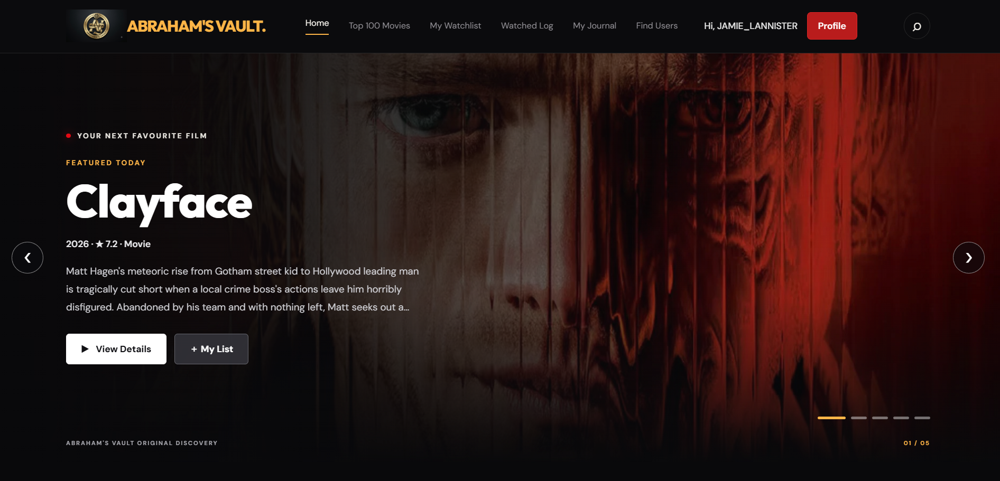
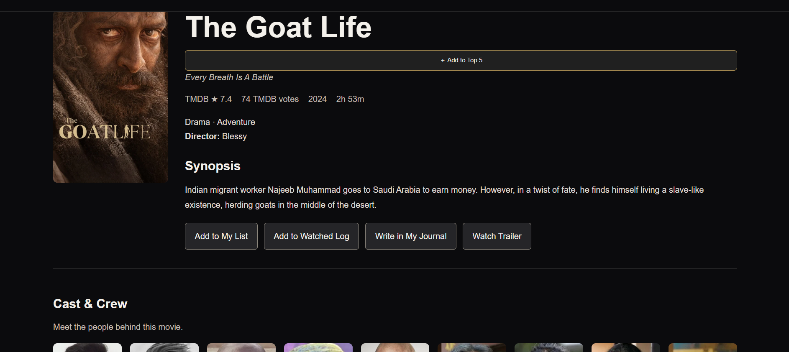
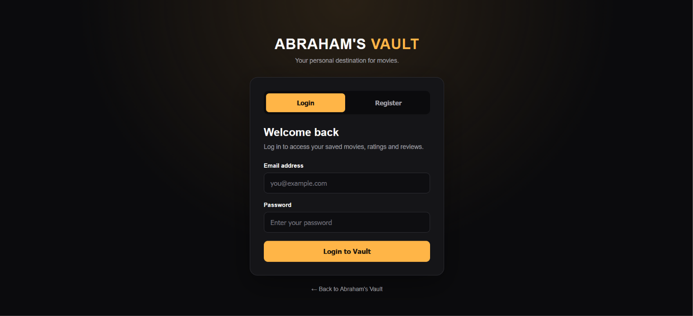
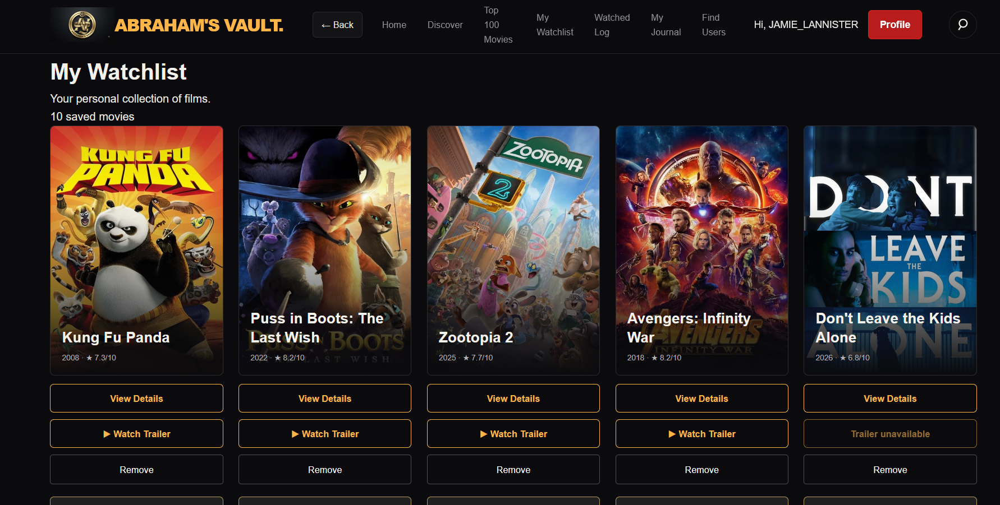
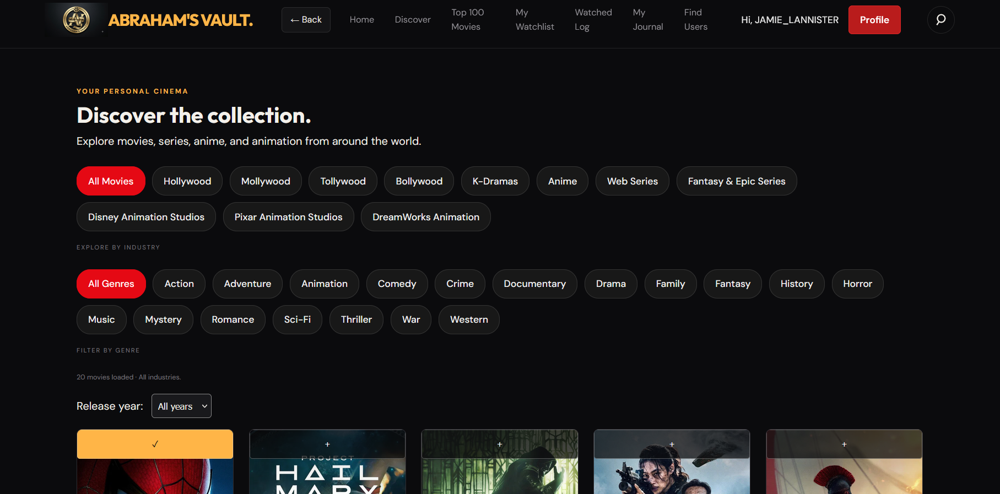
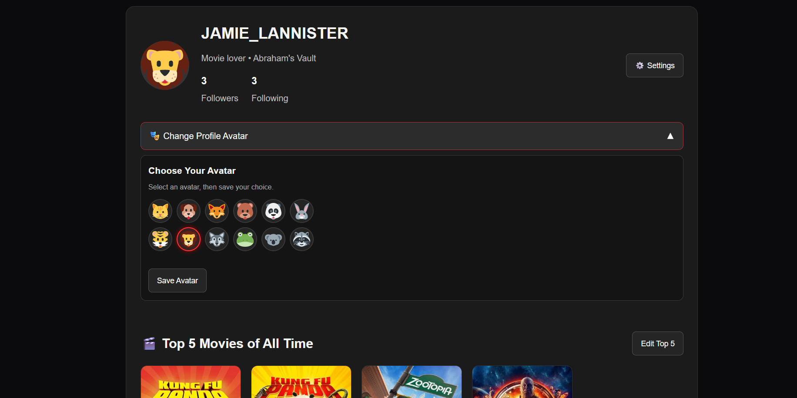
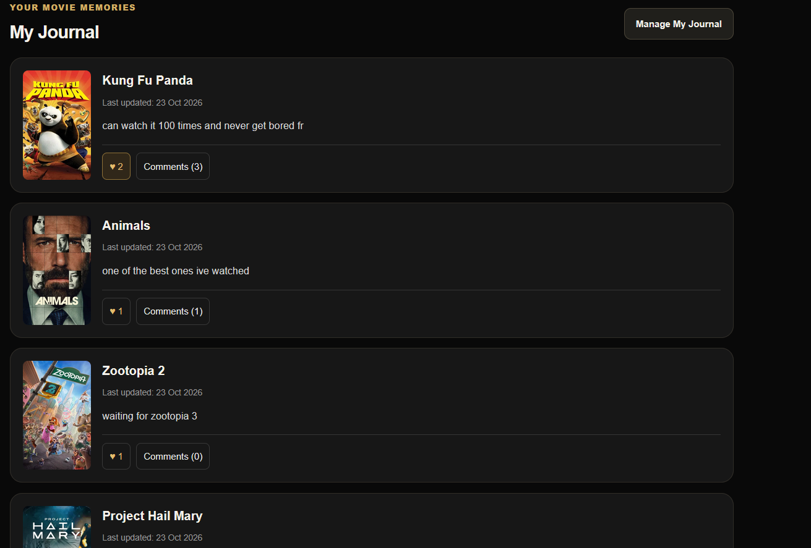
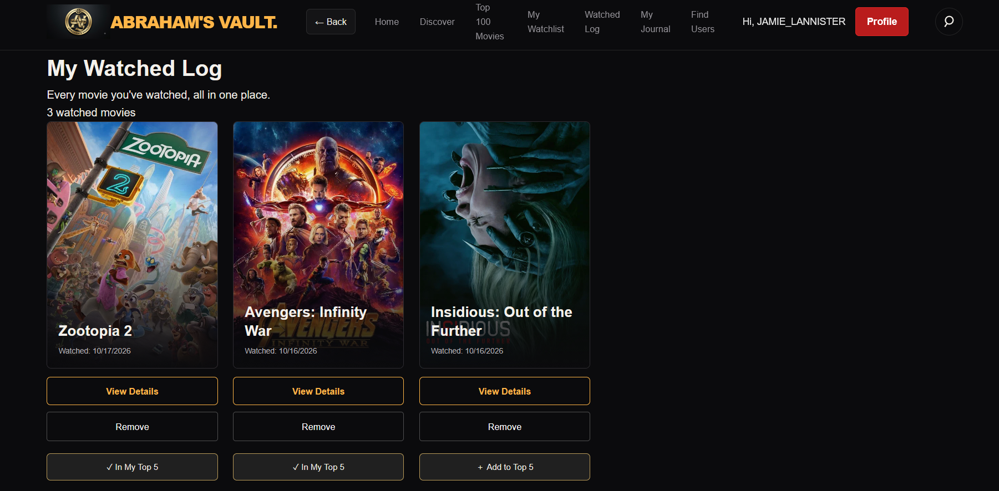

# 🎬 Abraham's Vault

**Discover movies. Explore stories. Build your watchlist.**

Abraham's Vault is a movie discovery web application that helps users explore films, view movie details, and keep track of movies they want to watch. It combines a responsive web interface with a Node.js backend, MySQL database integration, and movie information from The Movie Database (TMDB) API.

🌐 **Live Website:** [abrahams-vault.onrender.com](https://abrahams-vault.onrender.com/)  
💻 **GitHub Repository:** [github.com/PThomas-01/abrahams-vault](https://github.com/PThomas-01/abrahams-vault)

## ✨ Features

- 🎥 **Movie Discovery** — Explore movies using data from the TMDB API.
- 🔍 **Movie Search** — Find movies and browse collections.
- 🎞️ **Movie Details** — Explore movie information and cast details.
- 🔐 **User Authentication** — Register and log in to your account.
- 📋 **Personal Watchlist** — Keep track of movies you want to watch.
- 👁️ **Watched Log** — Maintain a record of movies you've watched.
- ⭐ **Ratings and Reviews** — Rate movies and share your opinions.
- 📝 **My Journal** — Maintain a personal movie journal.
- 🏆 **User Profiles and Top 5** — Personalize your profile and showcase your favourite movies.
- 📱 **Responsive Interface** — Browse on desktop and mobile devices.
- 🗄️ **Database Integration** — Store application data using MySQL.

## 📸 Screenshots

<table>
  <tr>
    <td width="50%">
      
      <p align="center"><b>🏠 Homepage</b></p>
    </td>
    <td width="50%">
      
      <p align="center"><b>🎬 Movie Details</b></p>
    </td>
  </tr>
  <tr>
    <td width="50%">
      
      <p align="center"><b>🔐 Login Page</b></p>
    </td>
    <td width="50%">
      
      <p align="center"><b>📋 My Watchlist</b></p>
    </td>
  </tr>
  <tr>
    <td width="50%">
      
      <p align="center"><b>🎞️ Collections</b></p>
    </td>
    <td width="50%">
      
      <p align="center"><b>👤 User Profile</b></p>
    </td>
  </tr>
  <tr>
  <td width="50%">
    
    <p align="center"><b>📝 My Journal</b></p>
  </td>
  <td width="50%">
    
    <p align="center"><b>👁️ Watched Log</b></p>
  </td>
</tr>
</table>

## 🛠️ Tech Stack

| Technology | Purpose |
|---|---|
| HTML5 | Web page structure |
| CSS3 | Styling and responsive layouts |
| JavaScript | Frontend functionality |
| Node.js | Backend runtime |
| Express.js | Server and API routes |
| MySQL | Relational database |
| MySQL2 | Node.js database connectivity |
| bcrypt | Password hashing |
| JSON Web Token (JWT) | Token-based authentication |
| TMDB API | Movie information and metadata |
| Render | Application hosting |
| Aiven | Hosted MySQL database |
| Git and GitHub | Version control and source code management |

## 📂 Project Structure

```text
abrahams-vault/
├── frontend/
│   ├── assets/
│   ├── screenshots/
│   ├── index.html
│   ├── login.html
│   ├── signup.html
│   ├── movie-details.html
│   └── ...
├── backend/
│   ├── server.js
│   └── package.json
├── .gitignore
└── README.md
```

## 🚀 Deployment

The frontend and backend are hosted on Render, with MySQL database hosting provided by Aiven. Movie information is retrieved through the TMDB API.

## 🌱 Future Improvements

- Add more movie discovery filters and sorting options.
- Enhance movie details with additional cast and crew information.
- Improve ratings and review experiences.
- Expand accessibility and mobile responsiveness.
- Add automated testing and further performance improvements.

---


