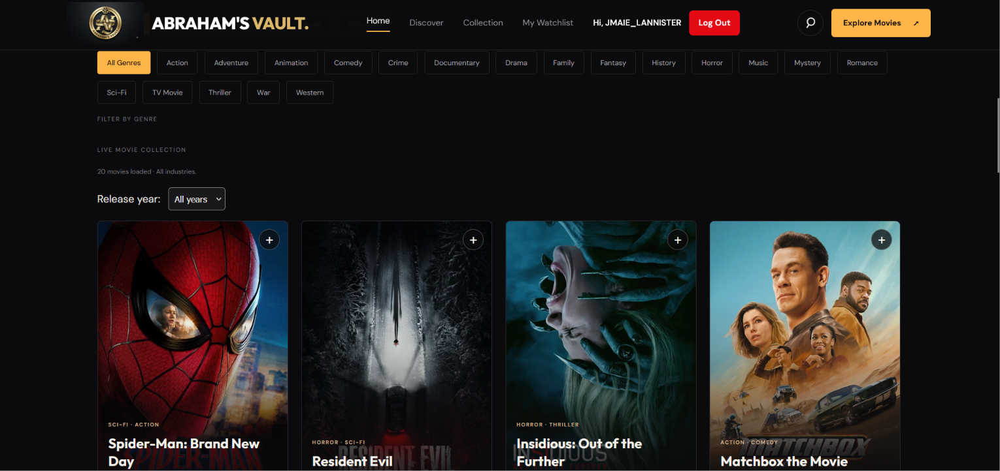
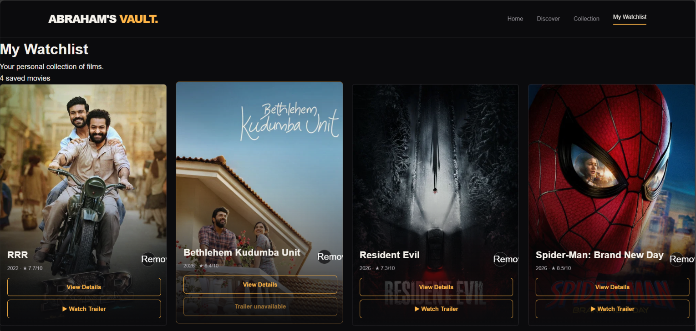

# 🎬 Abraham's Vault

**Discover movies. Explore stories. Build your watchlist.**

Abraham's Vault is a movie discovery web application that helps users explore films, view movie details, and keep track of movies they want to watch. The project combines a responsive web interface with a Node.js backend, MySQL database integration, and movie information from The Movie Database (TMDB) API.

🌐 **Live Website:** [https://abrahams-vault.onrender.com/](https://abrahams-vault.onrender.com/)
💻 **GitHub Repository:** [https://github.com/PThomas-01/abrahams-vault](https://github.com/PThomas-01/abrahams-vault)

## ✨ Features

- 🎥 **Movie Discovery** — Explore movies using data from the TMDB API.
- 🔍 **Movie Search** — Find movies and browse available collections.
- 🎞️ **Movie Details** — View movie information and available cast details.
- 🔐 **User Authentication** — Registration and login functionality.
- 📋 **Personal Watchlist** — Add and remove movies from your list.
- ⭐ **Ratings and Reviews** — Movie feedback functionality supported by the application.
- 📱 **Responsive Interface** — Browse the application on desktop and mobile devices.
- 🗄️ **Database Integration** — MySQL support for application data and backend features.

*Note: Feature availability on the live website depends on the deployed frontend, backend, database, and API configuration.*

## 📸 Screenshots

### 🏠 Homepage


### 🎬 Movie Details


### 🔐 Login Page


### 📋 My Watchlist


## 🛠️ Tech Stack

| Technology           | Purpose                                    |
| -------------------- | ------------------------------------------ |
| HTML5                | Web page structure                         |
| CSS3                 | Styling and responsive layouts             |
| JavaScript           | Frontend functionality                     |
| Node.js              | Backend runtime                            |
| Express.js           | Server and API routes                      |
| MySQL                | Relational database                        |
| MySQL2               | Node.js database connectivity              |
| bcrypt               | Password hashing                           |
| JSON Web Token (JWT) | Token-based authentication                 |
| TMDB API             | Movie information and metadata             |
| Render               | Web application hosting                    |
| Git and GitHub       | Version control and source code management |

## 📂 Project Structure

```text
abrahams-vault/
├── assets/
├── backend/
│   ├── server.js
│   ├── package.json
│   └── .env
├── screenshots/
├── index.html
├── login.html
├── signup.html
├── movie-details.html
├── movie-details.css
├── movie-details.js
├── my-list.html
├── navbar.js
├── script.js
├── style.css
├── watchlist.js
├── .gitignore
└── README.md


## 🌱 Future Improvements

- Improve movie discovery with additional filters and sorting.
- Enhance cast and crew information on movie detail pages.
- Improve ratings and review experiences.
- Strengthen error handling and loading states.
- Expand mobile responsiveness and accessibility.
- Improve automated testing and production deployment.

##
